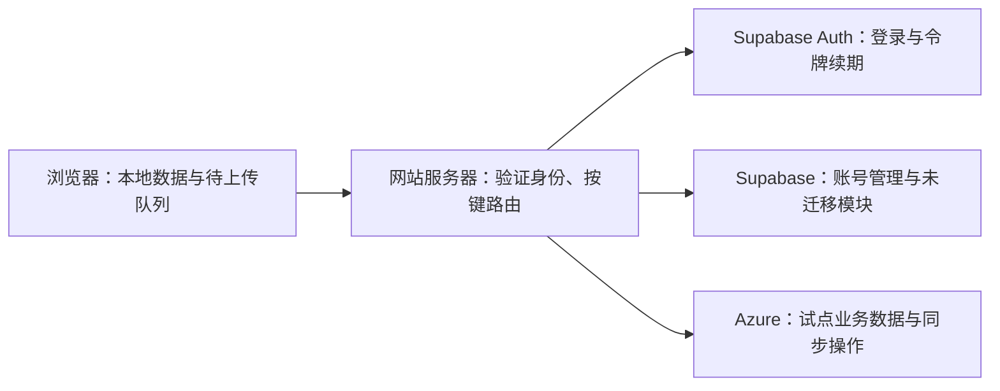

# Azure 与 Supabase 混合数据库可行性研究

研究日期：2026-10-06（北京时间）。代码基线：3.19.3 / 339755e。
本次仅研究与记录；没有创建 Azure 资源、迁移业务数据或切换网站数据库。

## 结论

技术上可行。结合学生订阅意向，优先验证 **Supabase Auth + Azure Database for PostgreSQL**，
而不是立刻把整个系统改成 Azure SQL。
前者更接近现有 PostgreSQL 架构、首年计算额度更适合长时间使用；
后者长期免费，但需重写 PostgreSQL 专用逻辑，而且免费计算额度不适合持续唤醒。

Azure 的主要潜在收益是容量、出站流量额度和资源选择，**尚无实测证明更快**。
推荐先试点计划表同步，验证费用和速度后再决定是否扩展。
Azure 账号尚因注册风控未开通，当前无法验证个人订阅资格、区域配额、创建成功率和真实性能。

## 当前系统的权威证据

- 远程与本地工作分支核对一致：3.19.3，提交 339755e。
- Vercel API 查到对应提交的预览部署 READY，区域 hnd1（东京）；
  该部署 target 为 null，不能据此认定 jackyun.top 的生产版本已更新。
- Supabase API 查到数据库在 ap-northeast-1（东京），PostgreSQL 17，ACTIVE_HEALTHY。
- 数据库查询：115,633,299 字节（约 110 MiB）；public 下有 82 张业务表、
  82 张启用行级权限的表、63 个函数；legacy_sync_data 有 249 条记录。
- 最大计划表 JSON 为 1,587,071 字节。调用链不仅涉及数据，还涉及设备登记、
  操作去重、删除标记、版本号、冲突处理和备份。
- 本地有 74 个 SQL 迁移文件；88 个源文件包含数据库表或 RPC 调用。
  这些是依赖规模，不能直接换算为迁移工时。
- 30 秒同步计时器在无待上传操作时退出，不是每 30 秒必定请求数据库。
  连续编辑、切回页面、备份和其他接口仍可能让新数据库持续活动。

代码定位：

- [同步读写接口](../src/app/api/sync/v2/route.ts)
- [大数据分片](../src/app/api/sync/v2/large/route.ts)
- [同步事务与设备校验](../src/lib/sync/server.ts)
- [浏览器待上传队列](../src/components/layout/local-workspace-sync.tsx)
- [同步时间与版本规则](../supabase/migrations/20260905085645_automatic_web_sync_lww.sql)
- [备份恢复入口](../src/actions/backup-center.ts)
- [导入导出](../src/actions/export.ts)
- [网站区域配置](../vercel.json)

## 选型和免费额度

| 方案 | 当前官方免费额度 | 与现有系统的关系 | 判断 |
| --- | --- | --- | --- |
| Supabase 保持现状 | 当前组织 5 GB 未缓存出站额度 | 改造最少，3.19.3 已减少重复传输 | 保留作对照与现有服务 |
| Azure SQL Database 免费套餐 | 每库每月 100,000 vCore 秒、32 GB 数据、32 GB 备份；订阅有效期内更新 | SQL Server 引擎，需适配类型、事务、权限、数据库函数 | 可做试点；长时间使用不一定免费 |
| Azure Database for PostgreSQL | 新客户符合资格时，前 12 个月每月 B1MS 750 小时、32 GB 数据、32 GB 备份 | 保留 PostgreSQL 数据类型和大部分 SQL；仍需改身份与访问层 | 学生首年优先候选 |
| Azure 上自建 Supabase | Supabase 软件可自托管；计算、磁盘和运维另算 | 迁移完整栈，不等于 Azure 免费 SQL | 当前不作为首选 |

SQL 套餐允许每订阅最多十个免费数据库，但不能当作同一业务的共享计算池。
额度用尽可暂停到下个月或继续计费；微软指出免费套餐没有 SLA。
Azure for Students Starter 与 SQL 免费套餐不兼容。
标准 Azure for Students 的注册资格和创建页面免费标记仍需实际确认。
[SQL 免费套餐](https://learn.microsoft.com/en-us/azure/azure-sql/database/free-offer?view=azuresql)、
[SQL FAQ](https://learn.microsoft.com/en-us/azure/azure-sql/database/free-offer-faq?view=azuresql)。

标准学生方案提供 12 个月内使用的 100 美元额度，并可在符合学生资格时按年续订。
不要把订阅续订理解成 PostgreSQL 新客户首年免费服务一定重新计算；
第 13 个月应按账号实际报价核算。
[学生方案](https://azure.microsoft.com/en-us/free/students/)、
[教育 FAQ](https://learn.microsoft.com/en-us/azure/education-hub/faq)、
[免费服务目录](https://azure.microsoft.com/en-us/pricing/free-services/)。

Azure PostgreSQL B1MS 为 1 vCore、2 GiB 内存，采用 CPU 积分机制，
持续高负载会受积分限制，不能只根据品牌判断性能。
扩展须加入允许列表，托管管理员也不是普通 PostgreSQL 超级用户。
[计算规格](https://learn.microsoft.com/en-us/azure/postgresql/compute-storage/concepts-compute)、
[扩展限制](https://learn.microsoft.com/en-us/azure/postgresql/extensions/how-to-allow-extensions)、
[角色与权限](https://learn.microsoft.com/en-us/azure/postgresql/security/security-access-control)。

## Azure SQL 的计算额度是否够用

SQL serverless 按 CPU、内存与最低配置的最大等效值计量，未暂停时不是“没有查询就不消耗”。
以下用最低 0.5 vCore 等效计算量作乐观下界，按 30 天月估算：

| 每天保持唤醒 | 月 vCore 秒下界 | 免费额度占用 |
| --- | ---: | ---: |
| 1 小时 | 54,000 | 54% |
| 2 小时 | 108,000 | 108% |
| 4 小时 | 216,000 | 216% |
| 8 小时 | 432,000 | 432% |

100,000 / 0.5 / 3600 = 55.56 小时/月，约每天 1.85 小时；
这不是保证运行时长。内存占用、较高 CPU、每次用完后的暂停等待都会降低可用时间。
自动暂停最短等待 15 分钟，保持打开的数据库会话也可能阻止暂停。
[计量公式](https://learn.microsoft.com/en-us/azure/azure-sql/database/serverless-tier-billing?view=azuresql)、
[serverless 配置](https://learn.microsoft.com/en-us/azure/azure-sql/database/serverless-tier-overview?view=azuresql)、
[暂停与恢复](https://learn.microsoft.com/en-us/azure/azure-sql/database/serverless-tier-auto-pause-resume?view=azuresql)。

因此，全天编辑的学习工作台，比偶尔点开的演示网站更容易耗尽 SQL 免费计算量。
连接池需要小规模且及时回收空闲连接，后台不能用查询保持唤醒。
以 Azure 指标 app_cpu_billed 的实际值预测整月，不能用请求次数估算费用。

国际 Azure 普通 Internet Egress 定价当前含每月前 100 GB 免费，
中国区域另列、其他传输类型及服务收费需分开核算。
这不是每个 SQL 数据库额外独占 100 GB，也不免除网站服务器、存储和网络产品的费用。
当前 5.358 GB 的 Supabase 量在数值上低于此额度，但迁移后必须按实际计费范围复核。
[Azure 带宽价格](https://azure.microsoft.com/en-us/pricing/details/bandwidth/)。

## 速度分析

当前链路是浏览器 → Vercel 东京 → Supabase 东京。
Azure 候选首先比较 Japan East；若将 API 一并移到香港，再比较 East Asia，
而不是保留东京服务器却只因用户在中国就把数据库放到香港。

暖连接下可能通过批处理、事务内合并和较少往返提高速度，但地域相近也不能保证跨云链路相同。
SQL 从暂停恢复通常约一分钟，初次连接可能返回 40613，需要重试。
网站现有同步请求超时 45 秒、数据库请求超时 30 秒，
直接换驱动可能导致“免费数据库正常唤醒，但网站先报同步失败”。
[官方恢复行为](https://learn.microsoft.com/en-us/azure/azure-sql/database/serverless-tier-auto-pause-resume?view=azuresql)。

必须分别测：

1. 从同一网站服务器发出的暖连接小记录查询，至少 100 次，比较 p50/p95。
2. 约 1.59 MB 计划表的完整下载、修改上传、保存并读回，不以 SELECT 1 替代。
3. SQL 空闲超过暂停等待后的第一次同步；至少三轮，记录恢复时间和错误率。
4. 中文/表情、大数据分片、低速网络和移动设备恢复队列。
5. 连续编辑一小时、空闲一小时的计算额度及出站字节数；按代表性使用日投影。
6. 相同客户端、相同服务器区域、相同操作集，比较已修复的 Supabase 基线；
   不能拿 Azure 与旧的高流量实现相比后宣称数据库本身更快。

尚未执行上述 Azure 实测，当前没有延迟或成本的实测优势结论。

## 混合架构和必须改造的部分

Supabase 托管项目仍使用自己的 PostgreSQL；这是网站同时连接两个服务，
不是把 Supabase SDK 的 URL 换成 Azure 数据库连接串。

| 当前机制 | Azure PostgreSQL 适配 | Azure SQL 适配 |
| --- | --- | --- |
| Supabase SDK 表查询 / RPC | 新服务器数据访问层或专用 API | SQL Server Node 驱动与参数化查询 |
| JSONB、UUID、timestamptz | 同类类型较容易保留 | 设计为 JSON 文本或支持的 JSON 类型、uniqueidentifier、datetimeoffset |
| PL/pgSQL 同步函数 | 改身份与角色依赖后复用 | T-SQL 存储过程或服务器事务重写 |
| auth.uid() 和 RLS | 服务器验证令牌后，事务内设置业务用户上下文，运行角色不可绕过 RLS | 服务器授权 + SQL 权限策略，可用 SESSION_CONTEXT 传入可信身份 |
| references auth.users | 本地身份映射与删除流程；跨数据库无原生外键 | 同样需要身份映射与清理 |
| 备份、恢复、导入导出、管理员远程操作 | 所有已迁移数据的读写入口须按来源路由 | 同样要求，另外要适配 SQL 方言 |

Node.js 可以连接 Azure SQL，JSON 可使用 nvarchar(max) 存储。
[Node 查询示例](https://learn.microsoft.com/en-us/azure/azure-sql/database/connect-query-nodejs?view=azuresql)、
[JSON 支持](https://learn.microsoft.com/en-us/azure/azure-sql/database/json-features?view=azuresql)。
SQL Server 支持应用传入 SESSION_CONTEXT 的行级权限。
[SQL 行级权限](https://learn.microsoft.com/en-us/sql/relational-databases/security/row-level-security?view=sql-server-ver17)。

服务端验证 JWT 的签名、发行者、过期时间和用户标识，不能信任浏览器提交的 user_id；
支持非对称签名时可缓存 JWKS 来减少每次向 Auth 查询的开销。
连接池中的用户上下文必须在同一事务/连接上设置并清理，测试交替两个用户，防止串号。
账号停用与删除仍需要明确同步；迁出数据库不代表可以忽略账号状态。
[Supabase JWT 验证](https://supabase.com/docs/guides/auth/jwts)。

Supabase 组织若整体受限，登录和续期仍可能失效。已有有效令牌可在符合签名验证、
状态检查和过期策略时继续访问 Azure，但不能宣称全面脱离 Supabase 停服风险。

## 网络部署的额外门槛

Vercel 默认出站 IP 动态变化，数据库 IP 白名单不能只加入某次观察到的地址。
静态 IP / Secure Compute 有套餐和费用条件。
[官方 Vercel 说明](https://vercel.com/kb/guide/how-to-allowlist-deployment-ip-address)。

Azure SQL 的“允许 Azure 服务”不会自动允许 Vercel；该设置也并非只允许自己的订阅。
[Azure 防火墙说明](https://learn.microsoft.com/en-us/azure/azure-sql/database/firewall-configure?view=azuresql)。
候选方案为受控的静态出站网络，或 Azure 同区域的业务 API；
后者仍需预算 API 计算、冷启动、网络与日志费用。不能为省事将数据库开放给所有 IP。

外部 Azure SQL 客户端默认走 Proxy；Redirect 可减少延迟，
但需额外出站端口和驱动支持，必须验证部署环境而不是套用本机连接结果。
[连接架构](https://learn.microsoft.com/en-us/azure/azure-sql/database/connectivity-architecture?view=azuresql)。

## 试点与迁移计划

1. **账号资格**：注册成功后确认是标准 Azure for Students，而非 Starter；
   创建页核对免费标记、B1MS、32 GB、可选区域，以及使用期限。
2. **只建测试资源**：保留 Supabase 正式数据。先在 Azure 测试库验证数据类型、
   用户隔离、设备撤销、并发写入和幂等重试，不创建全站同步复制任务。
3. **数据访问层**：保持浏览器既有同步协议，按 storage_key 和用户决定唯一写入位置。
   候选试点为计划表，连同它的设备、去重、删除和备份逻辑；其他模块继续使用 Supabase。
4. **完整行为验证**：保留 canonicalJson 内容哈希、revision、client_updated_at、
   同时修改的决策、未来时间限制、空计划表保护、离线队列及恢复规则。
   同步设备、历史操作和删除标记必须一起处理，不能只复制 JSON。
5. **性能与费用门槛**：两用户隔离无泄露、重试无重复版本、并发无静默丢失；
   完整同步和恢复必须成功。建议暖连接 p95 至少改善 20% 才宣传速度提升；
   这是决策门槛，不是已测结果。SQL 免费方案建议预计月度计算占用低于 70%，留出余量。
6. **切换**：暂停试点键的云端写入，导出一致快照与校验值，导入并核对全部记录，
   再切换试点用户的路由。浏览器本地编辑和待上传队列保留；
   未迁移模块的读写路由不变。取消旧数据对应的重复上传和备份读取。
7. **回退**：切换前可直接取消；切换后如果 Azure 已接收新写入，
   必须冻结、导出最新状态及去重/版本元数据，反向核对再切回。
   不能只改环境变量，否则旧 Supabase 数据可能覆盖新数据。
8. **扩展**：试点至少覆盖代表性活跃和空闲日，再逐模块搬迁。
   第一阶段保持单一写入来源，不做跨数据库双写，不假设跨服务有原子事务。

## 尚未验证及决定

未验证：学生资格/区域资源配额、免费套餐实际应用、Azure 网络连通、
驱动部署、真实延迟、冷启动和账户账单。账户未开通时不把这些记为通过。

推荐顺序：标准学生账号开通 → Azure PostgreSQL 首年试点 → 同区域性能/费用实测 →
再选择长期付费 PostgreSQL、长期免费但受计算额度限制的 Azure SQL，或保留 Supabase。
若首要目标是永久零数据库费用，Azure SQL 值得测试；
若首要目标是现有工作台迁移顺畅、每天长时间使用，Azure PostgreSQL 更适合作为第一候选。
