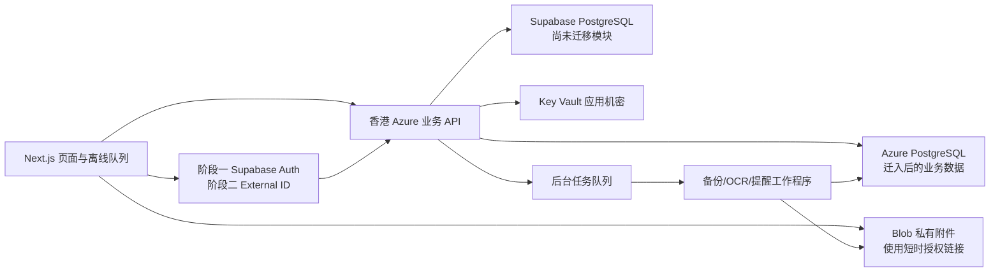

# JACKYUN.TOP Azure 平台改造计划

日期：2026-10-07。代码基线：ab9a890 / 3.20.0。阶段：服务盘点和实施计划。
本文件与 [完整免费服务清单](azure-service-catalog.md) 配套。尚未接入文件、机密、登录或通知服务；计划不等于上线。

## 目标与已核实状态

目标是让页面操作更流畅、云端同步可靠、文件可上传下载、机密集中管理，逐步支持 Azure 登录、Passkeys、后台提醒和恢复能力。

- 本地工作分支与对应远程一致，已执行 git pull origin main；当前工作分支含 main 之外的变更，计划 PR 以当前分支为基线。
- Azure 门户实查：JackYun 资源组有一个 PostgreSQL 灵活服务器 jackyunasia，Ready，East Asia，17.11，B1ms，32 GiB，高可用未启用。
- Supabase连接器同日实查：现有项目ACTIVE_HEALTHY，东京，PostgreSQL 17；健康状态不证明组织出站额度已恢复或网站同步成功。
- 终结点：jackyunasia.postgres.database.azure.com。未做 SQL 连接、数据导入或网站读写验证；Ready 不能证明应用可用。
- 订阅区域策略允许 eastasia、malaysiawest、uaenorth、centralindia、indiasouthcentral。每种服务的区域和 SKU 仍须分别验证。
- 当前 package.json 使用 Next.js 16.3.1、React 19.2.8。src/app/api 有 29 个 route.ts，portal 下有 19 个引用 LegacyFrame 的文件。
- [页面外壳](../src/app/(portal)/layout.tsx) 已有服务器身份读取、数据库查询、React 客户端组件。
- [LegacyFrame](../src/components/modules/legacy-frame.tsx) 下载旧 HTML 并注入脚本放入 iframe；[计划页](../public/Studyplan.html) 仍有大 JSON 序列化与计时器。
- [本地同步](../src/components/layout/local-workspace-sync.tsx)、[离线同步](../src/components/layout/offline-workspace-sync.tsx) 和 [Service Worker](../public/sw.js) 已存在，应保留离线能力。
- [登录](../src/actions/auth.ts) 仍依赖 Supabase Auth、profiles 与其 user_id。新数据库不会自动替代认证服务。
- vercel.json 配置 hnd1 东京；这只是仓库配置，不能证明当前生产部署的区域或版本。香港数据库跨云链路尚未实测。

结论：网站是新旧混合的动态应用，不是纯静态站。静态资源本身可缓存且很快；iframe 初始化、主线程工作、大对象读写、重复请求和网络往返是待测候选原因，不能未经测量直接归因。

## 推荐服务组合和体验收益

| 顺序 | 服务 | 可感知收益 | 费用或实施边界 |
| --- | --- | --- | --- |
| 第一批 | 已有 PostgreSQL | 业务数据逐模块迁入，减少旧同步的流量压力 | B1ms 不推荐生产重负载；监测 CPU 积分；首年免费到期需预算 |
| 第一批 | Blob Storage | 附件直接上传、断点重试、下载不阻塞同步 | 普通 GPv2、Standard、LRS、Hot；私有容器；容量、请求、流量分别计量 |
| 第一批 | Key Vault Standard | 密码和第三方密钥不散落代码，便于轮换 | Azure 后端用托管身份；机密按版本缓存，不每请求读取 |
| 第一批 | Container Apps Consumption | 香港业务 API 统一身份验证、数据库访问与文件授权 | 选择一个后端；试点 min replicas 0/max 1，冷启动实测后再定常驻费用 |
| 第一批 | Cost Management + Monitor 基础指标 | 发现超额和故障，避免再次突然不能同步 | 预算仅提醒；日志、告警、测试可能收费，先限制采样与保留 |
| 第二批 | Entra External ID | 统一客户登录和账号恢复，逐步降低 Supabase Auth 依赖 | 新 external tenant、应用和账号映射；不是工作账号目录直接替换 |
| 第二批 | Passkeys | 指纹/面容/PIN 登录，减少输入密码 | 与 Key Vault 无直接依赖；External ID 路径有域名、MFA与账号条件 |
| 第三批 | 通知中心或直接 Web Push | 到期提醒、任务处理完成、重要异常提醒 | 先站内通知，再用户主动订阅系统通知；Apple 路径单独验证 |
| 第三批 | Storage Queue，必要时 Service Bus | OCR、备份、提醒后台完成，前台不用等待 | 默认简单队列；需要高级消息机制再加 Service Bus |
| 按需 | Event Grid | 文件上传后触发处理 | 事件去重、乱序和失败重试必须处理 |
| 按需 | Document Intelligence、Speech、Translator | PDF提取、语音录入/朗读、翻译 | 由用户触发，展示进度；输入大小和日用量限制 |

采用 [vercel:create-a-backend](C:/Users/syf26/.codex/plugins/cache/openai-curated-remote/vercel/0.54.1/skills/create-a-backend/SKILL.md) 的按工作负载选服务原则：保留 Next.js 与现有 Vercel 前端，不因新增 Azure 就整体迁移前端。同步 HTTP 与后台任务分开，数据库与业务 API 尽量同区域。

## 存储不是可以相加的一块网盘

Blob 是网站对象存储；Azure Files 是可挂载共享文件夹；Managed Disks 是虚拟机磁盘；Container Registry 存镜像；Container Storage 服务容器持久卷。
100 GB Files、两个 64 GB 磁盘、100 GB 镜像仓库和 5 TiB 容器卷目录额度不能加起来成为网站附件空间。
当前没有共享盘挂载需求，第一批接 Blob；未来若 OCR 工作程序必须访问共享目录，再评估 Files。临时处理可用容器临时盘，完成后结果写回 Blob，不能把临时盘当备份。

Blob 建议：attachments、exports、backups 三个私有容器，同一香港存储账号；正式和测试数据用不同容器或账号。
业务表记录 owner_id、对象键、文件名、MIME、大小、内容哈希、状态和删除时间，不在数据库 JSON 中内嵌 base64 文件。
用户可见功能为上传进度、取消/重试、附件预览、下载、删除和空间占用；配额以应用策略为准，不向每个用户宣称独享 Azure 免费额度。

上传协议：API 校验用户与文件限制 → 签发短时、仅指定对象写入权限的 SAS → 浏览器直接上传 → API 核验实际对象属性并提交文件记录。
对象路径中的用户ID由服务器决定，不能信任客户端 owner_id。链接不可带容器列举或账号级权限；下载先授权再签发短时只读链接。
限制 CORS 为正式和受控预览来源；文件 MIME 不能只信上传头，隔离 HTML/SVG 等主动内容；失败上传定期清理，扫描服务费用另算。
删除同时处理业务记录和对象，软删除/版本控制按有界保留期启用，计入容量；备份记录哈希、时间、schema版本，并实际做恢复演练。
Azure 原生 7 天数据库备份与导出到 Blob 的逻辑备份分开计算，不能把附件容器当数据库自动备份。

## 两个数据库怎样分工

两库不是自动容灾或自动加速。第一阶段按模块确定唯一写入来源：先计划表与附件元数据迁 Azure，未迁移模块保留 Supabase。
最终主业务数据库为 Azure；Supabase 作为过渡服务退出日常写入。不要把两库设计成永远双写的同一份用户资料，也不要把跨库写入当作一个事务。

实施前盘点所有读写入口：页面、API、Server Actions、导入导出、备份恢复、管理员工具、AI工具、设备登记与离线队列。
保留记录版本、操作ID去重、删除标记、客户端时间边界、冲突规则、空计划保护、设备撤销；不得只复制 JSON 值。
以统一 app_user_id 作为业务身份，identity_links 唯一映射 issuer+subject 到 app_user_id。对现有用户尽可能保留原业务 UUID，迁移映射而非重新生成用户数据。
Azure 数据库普通运行角色不可绕过用户隔离；每个事务设置可信用户上下文并清理，测试连接池交替两用户。
Entra 令牌不能直接当 Supabase 会话使用；保留 Supabase 表时必须通过可信访问层授权，不能以 service_role 全局权限绕过业务隔离。

切换：试点用户相关键暂停云写入 → 一致快照与校验 → 导入记录/设备/操作元数据 → 验证 → 路由到唯一新来源 → 回放离线队列。
切换后回退：冻结 Azure 写入、导出最新业务和版本/去重元数据、反向校验再回旧库。直接切回旧连接串会丢掉切换后的新数据。

## Azure 登录与 Passkeys

推荐研究目标为 Entra External ID 的客户 external tenant；普通 Entra ID 工作目录不是客户登录系统的直接替代品。
目录中旧 Active Directory B2C 条目不能作为新账号方案：微软已停止向新客户销售 B2C。
External ID Basic 前 50,000 月活免费，与目录里的“50,000对象”不是同一计量；域名、Front Door、短信等另算。

Key Vault 保存应用机密；Passkey 私钥留在用户验证器，服务保存公钥信息，不能把用户 Passkey 私钥收集到 Key Vault。
External ID 当前可支持客户 Passkeys，但需 custom URL domain，现行官方域名路径使用 Front Door Standard/Premium。
首次注册需支持的本地密码账号与近期 MFA；邮箱一次性验证码和社交账号不能直接套用同样注册流程。
注册管理需专门实现，不能把官方高权限管理员样例直接用于客户自助。用户应可查看、增加、撤销凭据，丢设备后可恢复。
因此“Key Vault有免费额度，所以Passkeys免费上线”不成立，先核算 Front Door 与账号兼容性。若成本不合适，可另比较由 Azure 后端运行的成熟 WebAuthn 认证组件，保留 Azure 托管方向，单独评估会话、恢复和维护成本。

迁移顺序：建 external tenant与测试应用 → 服务端OIDC授权码流程、PKCE/state/nonce验证 → app_user_id映射 → 用户已认证情况下绑定双方身份 → 小范围双登录入口 → Passkeys → 验证后扩大迁移。
不要仅凭相同邮箱自动合并；既有 Supabase 密码不可假设能直接导入，应按官方可用迁移方式或受控重置/首次登录绑定。
旧管理员角色、封禁、白名单、第三方登录和恢复能力全部迁入，OIDC令牌校验发行者、受众、签名和有效期；会话Cookie保持 HttpOnly/Secure和CSRF保护。
先保留现有登录入口与管理员救援路径，逐步取消旧身份依赖。账号稳定性必须通过实际登录、续期、登出和恢复验证，不能仅以 Azure 品牌保证。

## 页面速度与交互改造

先分别量网络和浏览器主线程：冷/暖首屏、切页、计划输入、任务操作、完整同步，记录 p50/p95、LCP、INP、长任务、下载字节和请求次数。
用同设备、同数据、同网络的原版对照；同时在有VPN和无VPN网络测试。数据库Ready、SELECT 1或构建成功都不是用户体验证明。

1. 保留已有外壳，非必要偏好和公告延后加载；登录/网络失败时不长时间阻塞本地页面。
2. 优先迁原生页面：计划表/任务/目标，然后答题卡/学习记录。减少 iframe 文档重复解析、脚本注入和重复全局组件。
3. 大列表分页或虚拟化；大型编辑数据从同步 localStorage 迁到按用户隔离的 IndexedDB，异步持久化。必要计算放 Worker，避免每次输入整份 JSON.stringify。
4. 本地操作立即反馈，后台保存显示“待同步/已同步/失败可重试”；取消或合并过期请求，不因断网丢本地修改。
5. 记录级增量同步、条件请求和分页；图片/PDF走Blob直传，不经过Vercel多次转发；两用户缓存隔离。
6. 香港 API＋香港数据库实测，再比较 Vercel可用香港区域的前端服务器渲染；不提前宣称比东京更快。
7. 保留 PWA离线缓存、升级提醒、登录切换清理、旧 localStorage 键迁移兼容期；AI工具和人工操作同一数据源并触发相同刷新事件。

建议验收目标（尚无实测值）：核心操作 INP p75≤200ms，LCP p75≤2.5s，暖切页 p95≤1s；目标须在代表性移动设备验证。
完整同步字节数、p95耗时至少不劣于已修复的 Supabase 基线；新原生页面的同场景长任务时长降低30%以上。达不到就按证据继续优化，不用增加服务掩盖问题。

### 2026-10-07 请求样本与首项优化

用户提供的日志包含1000条记录：284次认证用户读取、130次资料读取、各122次通知/通知关闭状态读取、134次同步分块提交，以及37次小说正文和31次封面签名请求。此样本没有响应字节数，不能证明当日3GB出站的来源，也不是全天请求统计。
代码确认小说商店bootstrap逐个签发正文/封面链接。3.20.9改为对当前请求已授权的路径去重、每批最多100个签发，期限仍为3600秒；正文仍要求原套餐权限或图书归属，封面保持原显示规则，签名不跨用户缓存。
真实Supabase SDK配合受控HTTP响应的测试验证20个路径由20次签名请求减为1次，另覆盖空目录、单项/整批失败、大目录分批和不同用户请求隔离。此证据是请求数量及授权边界验证，未测量线上LCP/INP或证明3GB问题已经解决。
P3的原生页面和完整性能验收仍待实施；Azure数据库及应用切换仍由数据迁移验收独立决定。

## 通知、后台工作和运维

站内通知复用现有公告体系，增加每用户任务结果与已读状态；系统推送需用户主动订阅、时区/安静时段、去重、可退订。
Notification Hubs 已支持 Chrome/Edge/Firefox Web Push，但当前官方浏览器路径排除Safari，列出的iOS支持也有限。
JackYun若需要 iPhone PWA 提醒，应单独验证标准 Web Push/APNs及第三方路径，未验证前保留站内提醒，不承诺关闭页面必达。
推送只携带少量通用提示和路由，详细私人数据登录后读取；通知点击访问仍需授权。
SignalR/Web PubSub解决在线即时更新，不替代关闭页面后的推送，也不是数据库同步正确性的保障。

后台先用 Storage Queue；若选 Service Bus，统一一种消费队列而非重复接两套。
业务事务写入 outbox，异步投递；job_id幂等、指数退避、重试上限、死信/毒消息、租约和手动重跑。通知和文件事件重复投递不会重复扣费/发提醒。
定时备份覆盖两库过渡期，恢复演练包含对象链接、身份映射和数据版本。OCR/导出是异步任务，UI显示排队/处理中/完成/失败。

监控第一批：请求ID、错误率、同步队列积压、数据库连接数、CPU积分、存储占用、Blob字节/请求、推送失败、账单。
不记录访问令牌、SAS完整URL、密码或附件原文；日志采样、有界保留及每日预算，告警费用核实后启用。
用户2026-10-07补充要求尽量零费用，优先于原每月5美元试点预算；超额或新增收费资源先给出单价和用量估算。首批实查见 [费用核查](../azure/cost-review.md)。提醒金额待实际订阅账单与余额可用后确定。预算不是硬停机开关；不要以自动停库保护账单而导致生产同步中断。
Azure Files仅在共享目录需求出现时开；虚拟机、AKS、VPN网关和负载均衡器没有当前需求，不作为第一批基础设施。

## 分阶段交付与验证

| 阶段 | 可审阅交付物 | 完成证据 | 回退方式 |
| --- | --- | --- | --- |
| P0 盘点与预算 | 全服务清单、当前状态、性能采样方案、资源与费用清单 | 清单覆盖输入所有条目；资源门户与代码证据；成本指标和告警配置截图 | 文档可直接回退；预算尚待实际配置 |
| P1 文件与机密 | Blob/Key Vault配置、托管身份权限、附件API与UI、轮换说明 | 两用户隔离；超额/取消/重试；上传哈希；短时链接失效；密钥轮换无泄露 | 关闭新上传，保留新对象和元数据；提供旧附件读取 |
| P2 香港业务API与数据库 | Container Apps部署、普通DB角色、数据访问层、计划表迁移工具 | TLS连接；双方用户隔离；并发/离线/删除/幂等；1.59MB样本全流程；恢复演练 | 冻结与反向同步最新状态后切回，禁止单纯切连接串 |
| P3 页面性能 | 原生计划表/任务/目标页面、缓存与增量同步 | 同设备前后测量；旧键迁移；AI/人工同源；断网/切账号/升级不丢数据 | 每模块开关回旧页面，保持同一唯一数据源 |
| P4 Azure身份与Passkeys | 身份映射、OIDC、账号绑定/恢复、凭据管理 | 旧账号数据保留；邮箱不自动合并；封禁/管理员/续期/登出；Windows/macOS/iOS/Android验证 | 保留旧登录与已绑定映射，停止新增绑定，回退不删除身份 |
| P5 通知与后台 | 站内通知、推送订阅、队列与定时工作、运行看板 | 主动订阅/拒绝/退订、时区、重复事件、死信、Apple路径、备份恢复 | 停后台投递，保留队列与站内消息，无数据删除 |
| P6 扩展与退出旧依赖 | 逐模块迁移、最终备份、年度成本方案 | 每个入口按来源路由；无旧写入；全部账号/备份验证；首年后报价 | 观察期保留只读旧库，完成审核后决定退役 |

P1和P2先跑内部试点，再扩到全站。正式上线前核对第三方条款、费用和新增访问授权，给出具体可审阅配置；不会只为“有免费额度”批量创建服务。
本计划不把P1完成视作全部改造完成。全部目标包括文件、机密、Azure登录/Passkeys、原生页面体验、后台提醒、监控预算和模块迁移。
P0目前只完成盘点与计划；预算、性能基线和后续服务尚待实施，不能标记整个改造已完成。

## 资源与成本边界

第一批计划资源：已有 jackyunasia；香港 GPv2 Blob账号；Standard Key Vault；Consumption Container App＋环境；选择性日志/监控与预算。
建议名称 jackyunassets、jackyun-kv、jackyun-api，仅为候选，全球名称和区域可用性在创建前检查。
容器镜像可用已有可信仓库；若开 Azure Container Registry，首年后费用和镜像清理要预算。
数据库管理员只用于迁移，运行API用最小权限角色；Vercel不得通过公网全IP放行直接访问数据库。
同在Azure不代表固定出口/私网自动就绪；选VNet＋服务终结点或专用终结点等受控连接前分别核实产品支持与费用。
Key Vault优先RBAC和托管身份，运行服务仅读必要机密；Secrets User与Secrets Officer权限分开。
Passkeys阶段新增 external tenant/app、login.jackyun.top及可能的Front Door，单独做报价与DNS变更计划。

Container Apps每订阅每月免费180,000 vCPU秒、360,000 GiB秒、200万请求；0.25核/0.5GiB连续按活跃量计算约200小时免费量，不能推断24小时常驻免费，实际空闲计费按官方规则。
Functions按所选计划分别核实请求与计算量、必要存储；不把“一百万请求”当无限计算。
Key Vault 10,000次、Blob 5GB等目录首年额度不是永久零费用，且事务/容量/网络分别计算。
Private Link目录显示免费不等于所有私有终结点免费；AKS/Service Fabric/Batch/ML等控制面免费不等于底层计算免费。
首年到期前至少30天复核所有12个月额度、学生余额、存储、备份与网络报价；续订学生订阅不假设重置每种首年优惠。

## 官方依据（2026-10-07核查）

- [存储类型](https://learn.microsoft.com/en-us/azure/storage/common/storage-introduction)：Blob、Files与磁盘的用途不同。
- [Key Vault身份验证](https://learn.microsoft.com/en-us/azure/key-vault/general/authentication)：托管身份访问机密。
- [PostgreSQL规格](https://learn.microsoft.com/en-us/azure/postgresql/compute-storage/concepts-compute)：B1ms与生产负载边界。
- [学生额度](https://azure.microsoft.com/en-us/free/students/)：免费时间和额度；个人服务创建页仍需核对。
- [Container Apps计费](https://azure.microsoft.com/en-us/pricing/details/container-apps/)与[Functions计费](https://azure.microsoft.com/en-us/pricing/details/functions/)：计算与请求分别计量。
- [External ID定价](https://www.microsoft.com/en-us/security/pricing/microsoft-entra-external-id/)：Basic前50,000 MAU。
- [External ID Passkeys](https://learn.microsoft.com/en-us/entra/external-id/customers/how-to-sign-in-with-passkey)：域名、注册和恢复条件。
- [自定义登录域名](https://learn.microsoft.com/en-us/entra/external-id/customers/how-to-custom-url-domain)：Front Door配置依赖。
- [B2C FAQ](https://learn.microsoft.com/en-us/azure/active-directory-b2c/faq)：新客户销售限制。
- [Notification Hubs浏览器推送](https://learn.microsoft.com/en-us/azure/notification-hubs/browser-push)：支持和Apple限制。
- [Private Link计费](https://azure.microsoft.com/en-us/pricing/details/private-link/)：终结点和数据处理另计。
- [预算](https://learn.microsoft.com/en-us/azure/cost-management-billing/costs/tutorial-acm-create-budgets)：提醒不是硬上限。

完整目录里的额度是用户门户所贴内容，未逐项验证创建资格、SKU、停用状态或可用区域；详细见配套清单。所有速度改善目标均为待验收目标，没有伪装为性能实测。
